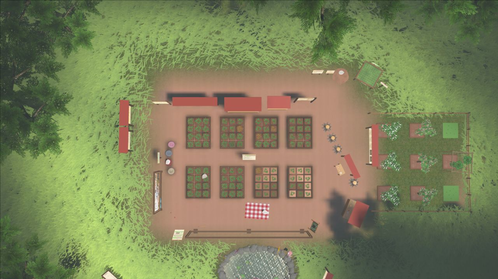
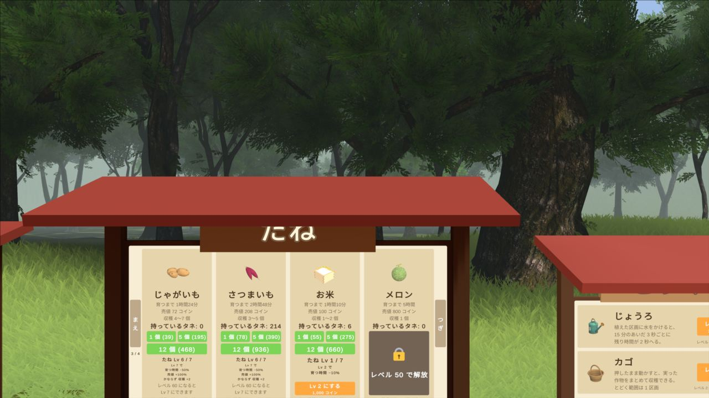
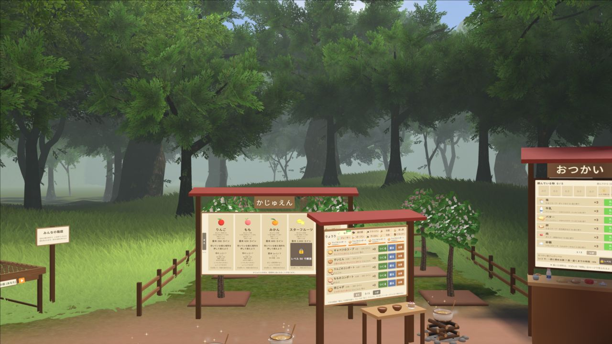

# World map: what is where

A field guide to the VRChat world this project automates (the "pocopoco farm" world), gathered by flying the in-game
stream camera around the world through OSC. It is meant for anyone building their own automation or just trying to
understand how the world is laid out. Everything here was observed directly; nothing is inferred from the world's
source. Numbers read from in-world boards may change when the world is updated.

## Layout at a glance

Seen from above (camera at height 30, pitch 88):

| Area | What it is |
| --- | --- |
| Soil clearing, left block | 8 farm plots in a 2 x 4 grid (12 planting cells each, 96 in total; see [Farm plots](#farm-plots)) |
| Right block | Orchard ("かじゅえん"): fruit trees on separate beds |
| Bottom | Round pond used for fishing, a picnic cloth, crates and benches |
| Edges | Red-roofed signboards (seed shop, orchard shop, requests, achievements, calendar, cooking menu) and a wooden fence |
| Around the clearing | Dense forest with fog. Nothing else is reachable from the clearing |

At height 60 the whole playable area is a small clearing in a large forest, so there is nothing to explore beyond it.

## Signboards (the game's menus)

All shop and progress features are world-space signboards you interact with by pointing and clicking. None of them are
needed to fish.

### Seeds ("たね")

Read from the seed board (prices in coins). Growth time is the base time, before the seed-level bonuses described on
the board.

| Crop | Grows in | Sell price | Harvest | Seed price (1 / 5 / 12) | Unlock |
| --- | --- | --- | --- | --- | --- |
| Potato (じゃがいも) | 1 h 24 min | 72 | 4-5 | 39 / 195 / 468 | - |
| Sweet potato (さつまいも) | 2 h 48 min | 208 | 3-5 | 78 / 390 / 936 | - |
| Rice (お米) | 1 h 10 min | 100 | 1-2 | 55 / 275 / 660 | - |
| Melon (メロン) | 5 h | 800 | 1 | - | Level 50 |

Seeds can be upgraded per crop (the board shows "たね Lv 6/7" style levels), which shortens the growth time and raises
the sell value. The page navigation buttons ("まえ" / "つぎ") flip between pages of the shop.

### Tools

- **Watering can (じょうろ)**: watering a planted plot removes 2 seconds of remaining growth time every 3 seconds for
  15 minutes.
- **Basket (カゴ)**: harvesting with the basket held collects all ripe crops within one plot at once.

### Orchard ("かじゅえん")

Fruit trees (apple, peach, mandarin, and a level-gated star fruit) are managed from this board. The board shows
prices and unlock levels; the details were not read in full.

### Other boards

- **Requests ("おつかい")**: a list of items to hand in (milk, butter, eggs, meat, sugar and so on) for a reward.
- **Cooking menu ("りょうり")**: recipes made at the campfire and cooking tables, built from harvested crops.
- **Achievements ("じっせき")**: progress list with the player's level and total experience.
- **Calendar ("カレンダー")**: a monthly calendar with daily bonus markers.
- **Helper cat ("お手伝いさん (ねこちゃん)")**: a small board that lets a cat helper do chores. The bot's
  `NekoCollector` reads this one.
- **Community sign ("みんなの箱庭")**: a small sign by the fence; its content was not read.

## Farm plots

- There are 8 plots, each a small soil square with a dark border holding 12 planting cells (96 in total).
- A planted, unwatered cell and a watered cell look different (watering darkens the soil and the sprout), which is how
  the project's `FarmGrid` decides cell state.
- Signboards stand close to the plots. At the default overhead angle the board roof can overlap the upper-left plots,
  which is why the camera pose uses a steep pitch of 88 degrees and a narrow offset from the plot centre.

## The pond

The pond is where all fishing happens. The instruction toast says "cast from 1-5 m away, point the rod tip at the
water" ("池から 1~5 m くらいの所で、竿の先を水へ向けて"). Casting while the view is not facing the water produces the
toast "池の水に向けて投げよう", which the bot treats as an aiming error.

## Using the stream camera to look around

You can fly the user camera anywhere with OSC (`/usercamera/Pose`, 7 floats: position x y z, rotation pitch yaw roll,
zoom) once the camera is open and streaming to Spout. The poses below were used to produce the pictures above.

| Pose (x, y, z, pitch, yaw, roll, zoom) | View |
| --- | --- |
| `0, 30, 0, 88, 0, 0, 56.6` | Straight down on the whole clearing |
| `0, 60, 0, 88, 0, 0, 56.6` | Straight down, wide: shows the forest around the clearing |
| `0, 3, 0, 0, 0, 0, 56.6` | Ground level looking at the seed board |
| `0, 3, 0, 0, 90, 0, 56.6` | Orchard board and the cooking area |
| `0, 3, 0, 0, 180, 0, 56.6` | The pond |
| `0, 3, 0, 0, 270, 0, 56.6` | Calendar, achievements and the music poster |

Coordinates are world coordinates, and the origin is close to the middle of the farm clearing. The tour used the in-app
farm shot command, then restored the saved pose, so a normal run is unaffected.

## Notes for automation authors

- Everything useful is readable from screenshots: boards use large, high-contrast Japanese text, so Windows OCR reads
  them reliably at 1280 px wide or more.
- The stream camera shows the world from any pose without moving the player, which makes it the safest way to inspect
  plots, boards, and other players without interfering with the avatar.
- The camera must be open for Spout to carry the picture; with it closed the stream shows the player's own view. The
  project pauses fishing around each shot so a cast click cannot land while the camera is open.
